# Xiangsu MG · MAV-MG

**Turn Chinese explanations into editable motion graphics for concepts, mechanisms, relationships and processes.** Provide a script or timed material and continue editing the resulting HyperFrames project.

[中文](README.md) · **English** · [Download the free noncommercial edition](https://github.com/maverickgao8848/mav-mg/releases/download/v0.1.0-preview.37/mav-mg-0.1.0-preview.37.zip) · [Pixel2All](https://pixel2all.cn/)

## Free edition and paid styles

Seven styles are included for noncommercial experimentation. **Pixel Emerald (`glass-lime`) and Pixel Platinum (`baijin-black-texture`) are paid styles, excluded from the repository and free download.** Their previews demonstrate finished work, not included templates.

Personal study, research, experimentation and hobby projects are permitted under the [PolyForm Noncommercial License 1.0.0](LICENSE). Commercial applications need separate permission. Model and speech-provider charges remain the user's responsibility. See the [Chinese usage explanation](USAGE.zh-CN.md) and [third-party notices](THIRD-PARTY-NOTICES.md).

## Made with DeepSeek

Suitable for **DeepSeek with WorkBuddy or another agent client that reads skills, edits local files and executes tools**, and for Codex. DeepSeek is the model; WorkBuddy provides an execution environment. An ordinary web chat alone does not install or execute the skill.

This actual 18-second DeepSeek-produced cache explainer uses **the paid Emerald style**, shown for demonstration. Attribution comes from recorded benchmark inputs. The silent GIF runs at original speed; click for MP4. An actual example demonstrates feasibility, not a universal quality or success-rate guarantee.

[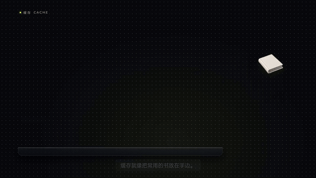](https://github.com/maverickgao8848/mav-mg/raw/refs/heads/main/assets/showcase/motion/deepseek-cache.mp4)

## Choose a public style

| Included style | Style ID | Preview |
| --- | --- | --- |
| Vermilion Theatre | `vermilion-theatre` | [](assets/styles/vermilion-theatre/FRAME.md) |
| Architectural Section | `architectural-section` | [](assets/styles/architectural-section/FRAME.md) |
| Engineering Atlas | `gable-reed` | [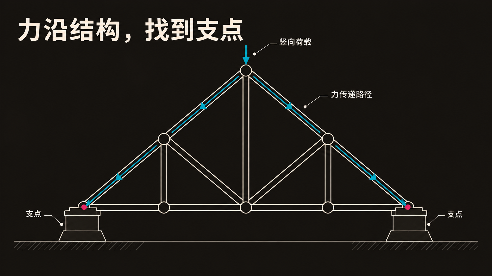](assets/styles/gable-reed/FRAME.md) |
| Terminal Manual | `opencode` | [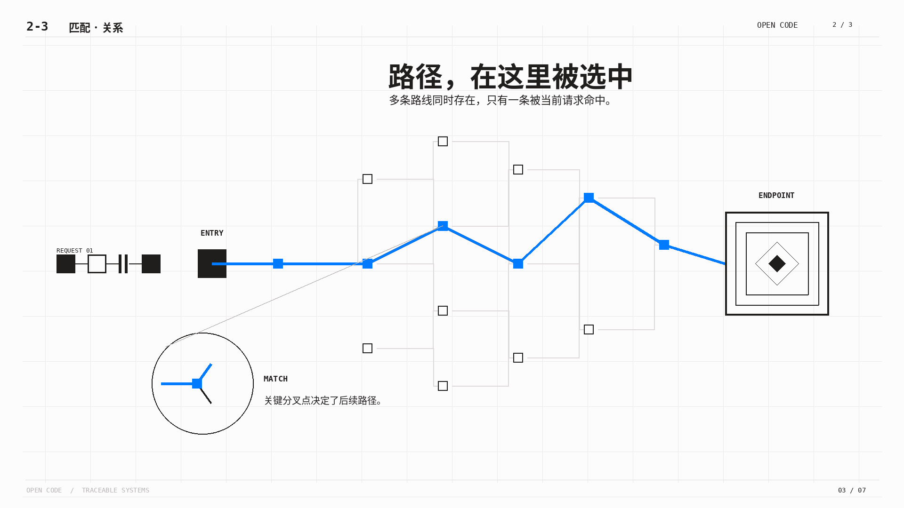](assets/styles/opencode/FRAME.md) |
| Cobalt Grid | `cobalt-grid` | [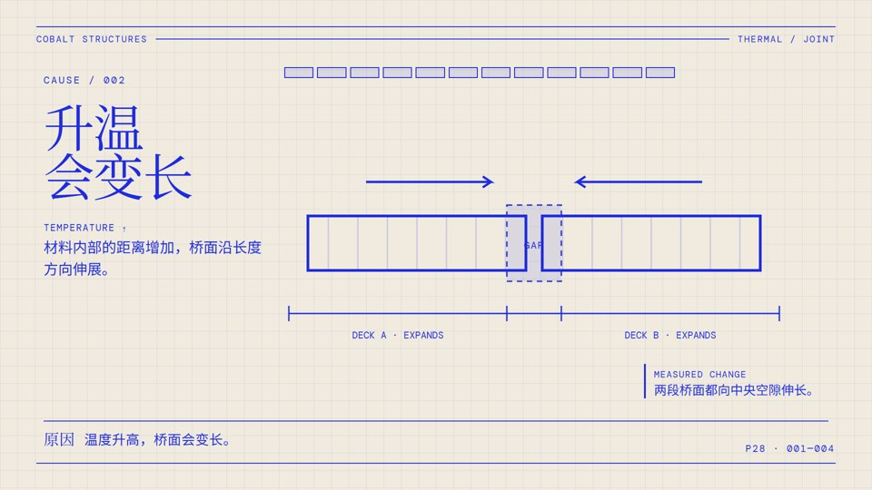](assets/styles/cobalt-grid/FRAME.md) |
| Retro Computer Catalog | `dell-1996` | [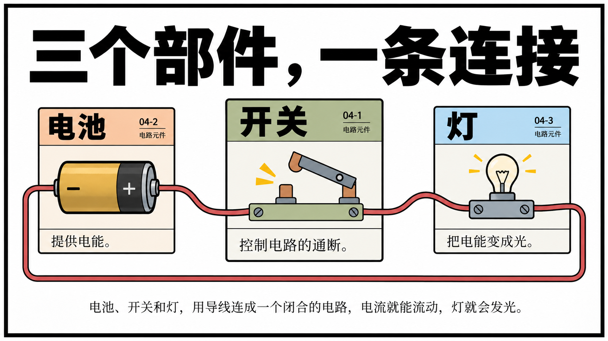](assets/styles/dell-1996/FRAME.md) |
| Broadside | `broadside` | [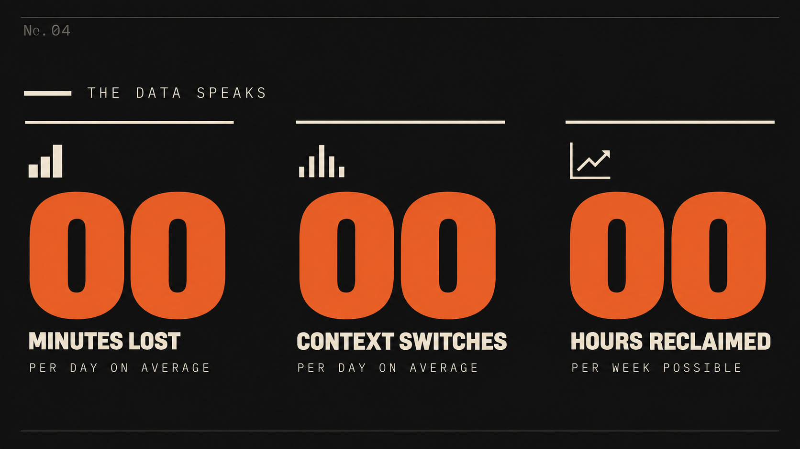](assets/styles/broadside/FRAME.md) |

Architectural Section is a selected static direction; continuous motion is not verified. Historical styles retain their recorded scope. Editorial Forest is no longer in the catalog. Original reference-image sets without recorded redistribution permission are omitted; written specifications and permitted resources remain available.

## Paid-style motion previews

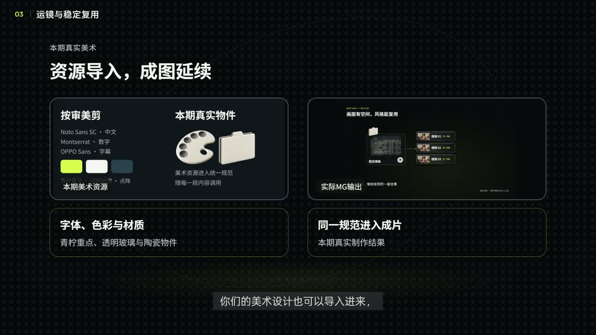

**Pixel Emerald — travelling through the production workflow:**

[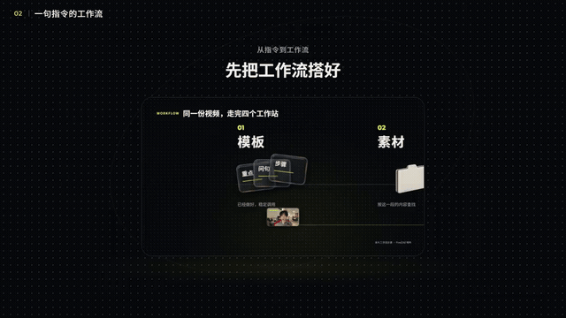](https://github.com/maverickgao8848/mav-mg/raw/refs/heads/main/assets/showcase/motion/emerald-workflow.mp4)

**Pixel Emerald — spatial cards and reusable styles:**

[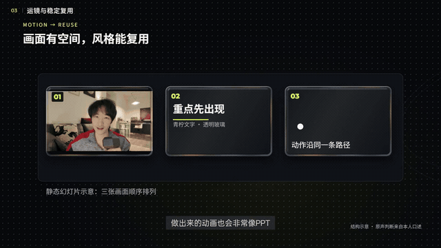](https://github.com/maverickgao8848/mav-mg/raw/refs/heads/main/assets/showcase/motion/emerald-depth.mp4)

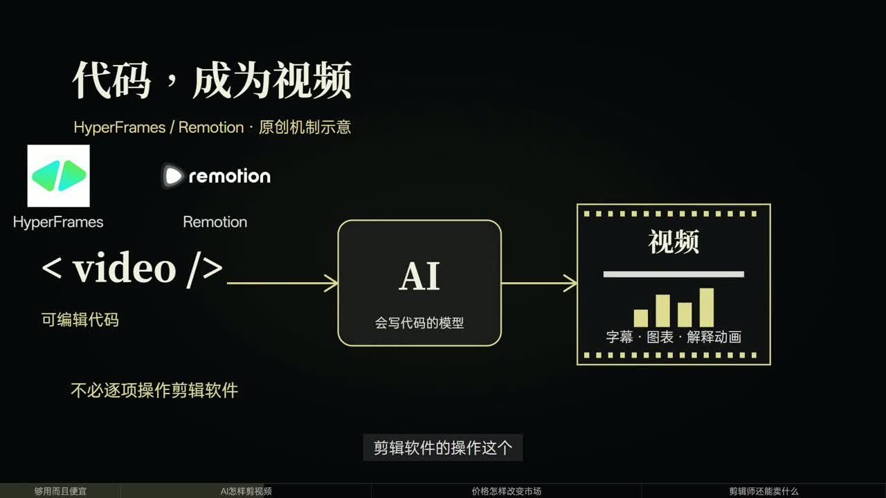

**Pixel Platinum — explaining a mechanism:**

[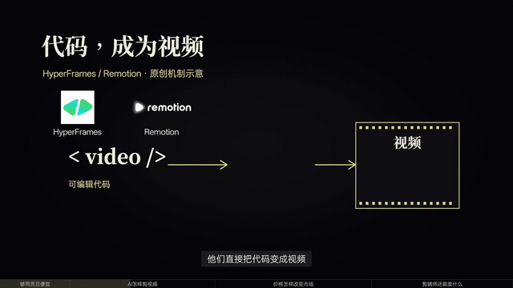](https://github.com/maverickgao8848/mav-mg/raw/refs/heads/main/assets/showcase/motion/platinum-mechanism.mp4)

**Pixel Platinum — relationships and scene handoff:**

[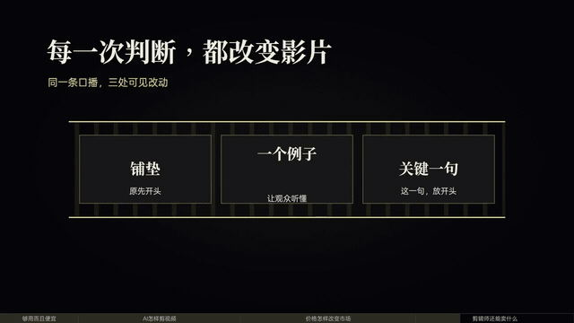](https://github.com/maverickgao8848/mav-mg/raw/refs/heads/main/assets/showcase/motion/platinum-handoff.mp4)

Emerald excerpts come from the author-selected `glass lime.mp4`; Platinum excerpts come from `mav editorial kit.mp4` in the same sample folder. Posters show completed layouts, rather than partially built frames. These are silent, original-speed excerpts. [Media provenance and cut ranges](assets/showcase/motion/sources.json). Commercial authorization, paid styles, tutorials and custom account styles are available separately through [Pixel2All](https://pixel2all.cn/).

## Content-led variation

Retain roughly 70% of the chosen visual language and mature expression, and use roughly 30% for topic-specific mechanisms, spatial action and handoffs where they improve understanding. Finish and readability apply throughout. These are creative priorities, not time quotas; the cache and negative-feedback studies are not fixed templates. See the [production guidance](references/content-led-variation.md).

The current main-branch method is preview.38; the download link still points to the published preview.37 archive.

## Install

Use Node.js 22+ and an AI client with local tool access. Extract the download and run at the package root:

```sh
node install.mjs
```

On Windows, `安装.cmd` runs the installer. It installs `xiangsu-mg` and 11 companion workflows, prepares the pinned runtime, Chrome and FFmpeg tools online, and preserves differing existing skills. For a clean project-local destination:

```sh
node install.mjs --destination <project>/.agents/skills
```

Reload your agent session and invoke `xiangsu-mg` with your script and chosen style. Default choices are Vermilion Theatre and Engineering Atlas:

```text
Use xiangsu-mg to turn this Chinese script into a knowledge explainer.
Choose Vermilion Theatre. Preview a representative segment first.
Keep the editable project, then export MP4 after review.
```

```sh
node scripts/apply-style.mjs --style vermilion-theatre --project <project>
```

Objects are obtained on demand and frozen into the project with provenance. New narration needs the user's Azure Speech setup; supplied audio does not. No credentials or author-machine binaries are included. See [installation details](DELIVERY.md).

## Preview scope

Chinese, 1920×1080, 30 fps. Supports scripts, fixed timing and reference timing. Project/Studio evidence reaches 300 seconds; actual video-export evidence reaches 81.3 seconds. New topics still need visual and playback review. See [release scope](references/release-scope.md).
