# 像素 MG · MAV-MG

**把一段中文讲解，做成有风格、可修改的知识解释动画。**

解释一个概念，演示一段流程，拆开一个机制，或者给口播补上一段看得懂的动画。提供文稿或带时间码的材料，由 AI 组织分镜、画面与运动，生成可继续修改的 HyperFrames 工程和视频。

**中文** · [English](README.en.md) · [下载免费体验版](https://github.com/maverickgao8848/mav-mg/releases/download/v0.1.0-preview.37/mav-mg-0.1.0-preview.37.zip) · [安装说明](DELIVERY.md) · [Skill 入口](SKILL.md) · [像素造物](https://pixel2all.cn/)

> **七套风格开放非商业体验，像素绿宝石与像素白金单独付费。** 个人学习、研究、兴趣创作可以免费使用；商业接单、品牌宣传、商业账号运营等用途需要另行授权。详见 [中文使用说明](USAGE.zh-CN.md) 与 [LICENSE](LICENSE)。Skill 免费，模型、配音等服务的实际费用由使用者承担。

## DeepSeek 也能做出这样的动画

适合在 **WorkBuddy 等能读取 Skill、操作本地文件和执行命令的 AI 客户端中配合 DeepSeek 使用**，也可以在 Codex 中使用。它把分镜、风格、素材、运动和检查组织成可重复执行的流程，让效果更稳定，也方便继续修改。

下面是 **DeepSeek 实际制作的《缓存》18 秒样片**，不是概念效果图。制作归属来自实际测试记录；使用了像素 MG 的**绿宝石付费风格**，作为能力展示，不代表免费包包含该风格。GIF 为原速静音预览，点击可打开 MP4。

[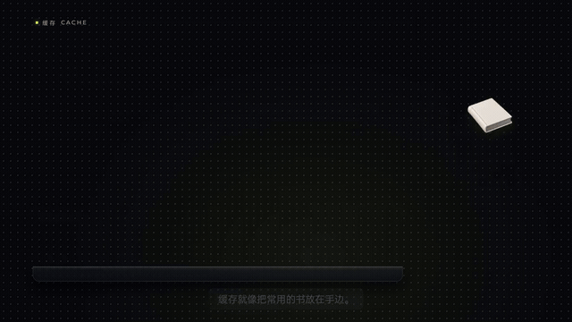](https://github.com/maverickgao8848/mav-mg/raw/refs/heads/main/assets/showcase/motion/deepseek-cache.mp4)

DeepSeek 负责理解与生成，WorkBuddy 等客户端提供文件和工具执行环境；只在普通网页聊天中粘贴文稿，不等于已经安装或运行此 Skill。样片说明这条制作路线可行，实际结果仍取决于模型、文稿、素材与修改过程。

## 看图选风格

以下 **七套风格均已包含在当前免费包内**，不再沿用“只有两套公开、其余都要付费”的旧划分。点击图片查看规范。配图包含实际预览帧和风格参考图，不代表每个新选题都会得到同一画面。

<table>
<tr>
<td width="50%"><a href="assets/styles/vermilion-theatre/FRAME.md"></a><br><b>朱砂活字剧场 · 已开放</b><br>实体文字、静物舞台与知识解释<br><code>vermilion-theatre</code></td>
<td width="50%"><a href="assets/styles/architectural-section/FRAME.md"></a><br><b>建筑剖面轴测 · 已开放</b><br>空间层级、系统结构与剖面表达<br><code>architectural-section</code><br><sub>当前为静态方向；连续运动尚未完成验证。</sub></td>
</tr>
<tr>
<td><a href="assets/styles/gable-reed/FRAME.md">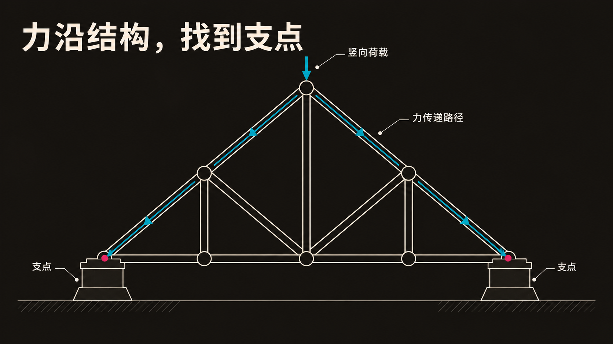</a><br><b>工程图册 · 已开放</b><br>结构、受力、路径与工程机制<br><code>gable-reed</code></td>
<td><a href="assets/styles/opencode/FRAME.md">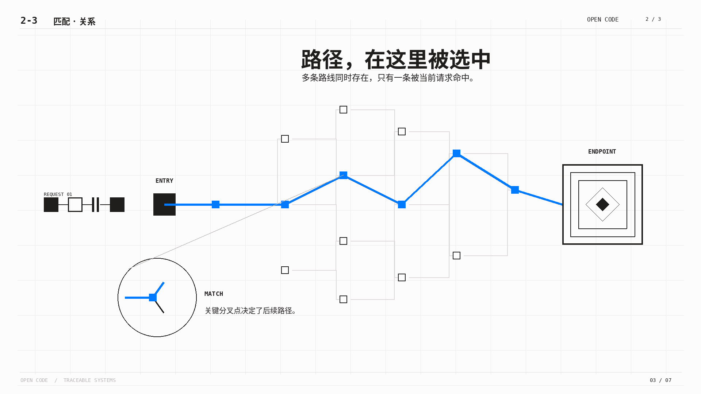</a><br><b>终端手册 · 已开放</b><br>软件、命令、状态与数字机制<br><code>opencode</code></td>
</tr>
<tr>
<td><a href="assets/styles/cobalt-grid/FRAME.md">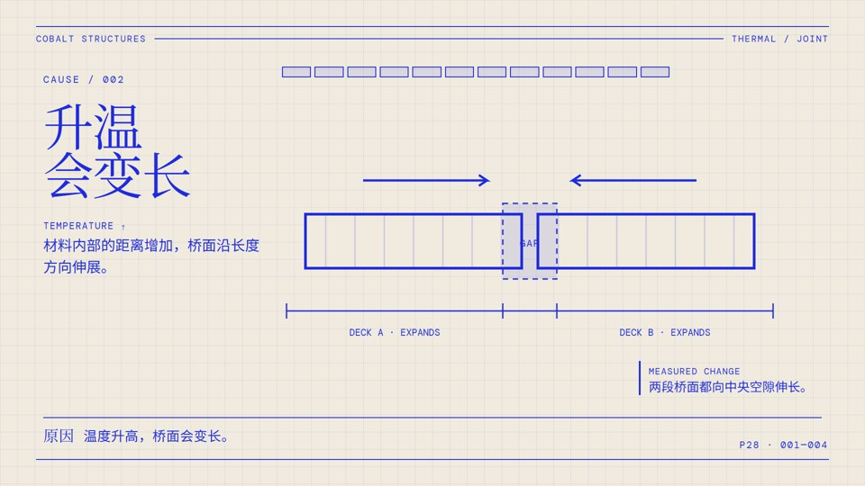</a><br><b>钴蓝网格 · 已开放</b><br>研究、数据与系统解释<br><code>cobalt-grid</code></td>
<td><a href="assets/styles/dell-1996/FRAME.md">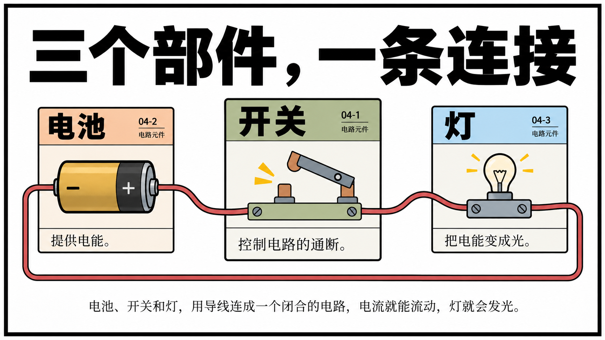</a><br><b>复古电脑目录 · 已开放</b><br>复古科技、索引与互联网文化<br><code>dell-1996</code></td>
</tr>
<tr>
<td colspan="2" align="center"><a href="assets/styles/broadside/FRAME.md">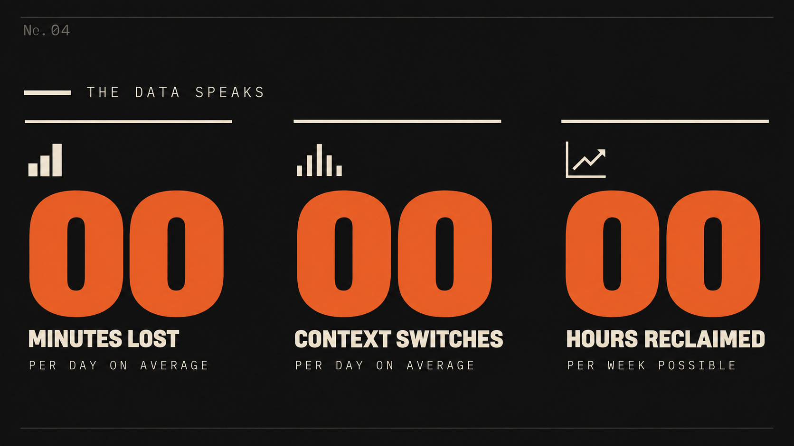</a><br><b>巨字海报 · 已开放</b><br>强观点、大字节奏与关系对照 · <code>broadside</code></td>
</tr>
</table>

未指定时，建议先从朱砂活字剧场或工程图册开始。部分旧风格保留历史验证范围，详见 [风格说明](references/style-contract.md) 与各自 metadata。开放使用不等于所有风格完成了同等程度的成片验证。旧 Editorial Forest 已退出当前列表。

## 像素绿宝石与像素白金 · 付费版效果

这两套风格可用于知识动画及对应的口播包装。**这里只展示成片效果，免费仓库与下载包均不包含它们的 Skill、完整风格规范和运行资源。** 动图取自已有样片，原速播放、移除音轨；点击可打开 MP4。

### 像素绿宝石

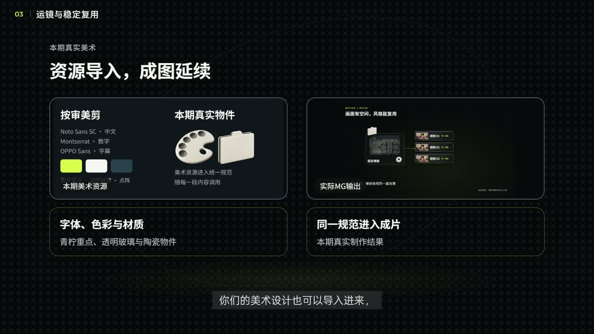

黑底点阵、荧光青柠、透明玻璃与白色物件。下面两段取自 `glass lime.mp4`：先沿模板、素材、动画、成片的工作流移动，再展开画面的空间层级与风格复用。

[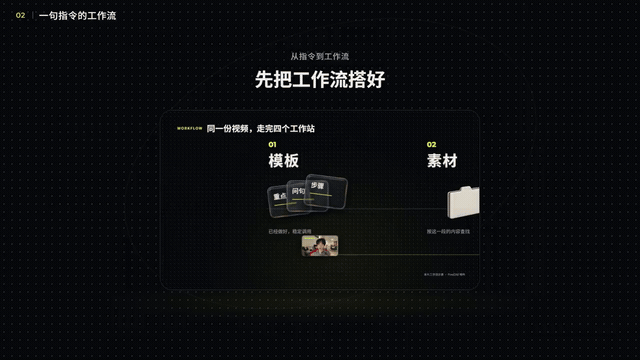](https://github.com/maverickgao8848/mav-mg/raw/refs/heads/main/assets/showcase/motion/emerald-workflow.mp4)

[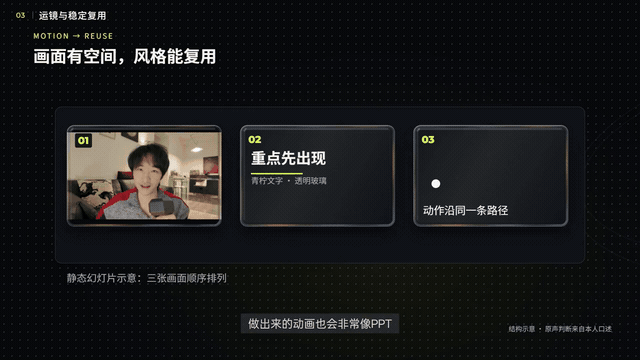](https://github.com/maverickgao8848/mav-mg/raw/refs/heads/main/assets/showcase/motion/emerald-depth.mp4)

### 像素白金

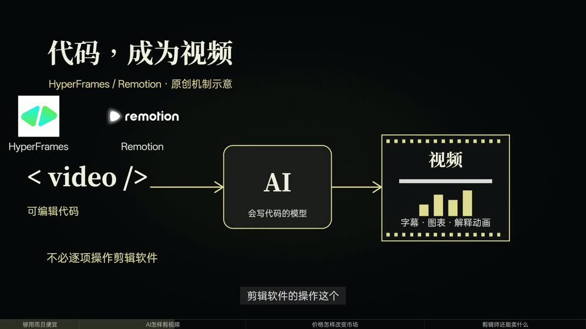

黑色纹理、暖白标题与浅金细节。下面两段取自 `mav editorial kit.mp4`，分别展示代码、AI 与视频的机制关系，以及三张内容卡的空间交换与重点突出。封面静帧取自元素全部到位后的画面。

[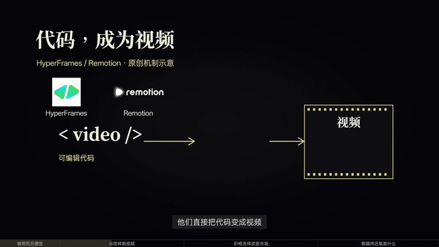](https://github.com/maverickgao8848/mav-mg/raw/refs/heads/main/assets/showcase/motion/platinum-mechanism.mp4)

[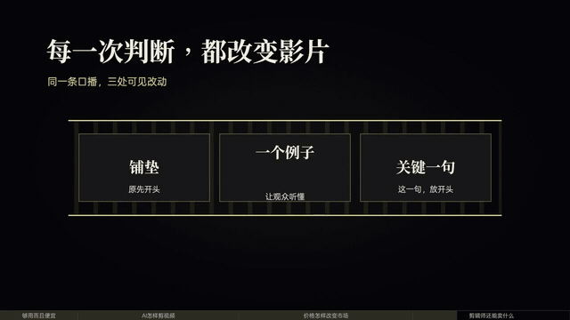](https://github.com/maverickgao8848/mav-mg/raw/refs/heads/main/assets/showcase/motion/platinum-handoff.mp4)

商业授权、付费风格、完整教学和账号风格定制，可通过 [像素造物官网](https://pixel2all.cn/) 联系。样片不承诺固定生成时间、费用或一次生成成功率。

## 内容驱动的变化

约70%延续所选风格与成熟表达，约30%在有解释价值的地方按内容设计机制、空间与转场。质感、可读性和空间一致性贯穿全片；比例用于创作重心，不机械计算时长，也不把缓存或负反馈样段变成固定模板。见 [制作方法](references/content-led-variation.md)。

当前 main 源码方法版本为 preview.38；页面下载入口仍指向已发布的 preview.37 冻结包。

## 开始制作

准备 **Node.js 22+** 与能执行本地工具的 AI 客户端。下载当前体验版，解压后在包根目录运行：

```sh
node install.mjs
```

Windows 也可以双击 `安装.cmd`。安装器装入像素 MG 和 11 个配套工作流，联网准备固定版本的 HyperFrames、Chrome、FFmpeg 和 FFprobe。已有同名但内容不同的 Skill 会被保留并报告冲突；如何选择其他安装位置见 [安装说明](DELIVERY.md)。

重新加载 AI 会话后，提供自己的文稿：

```text
调用 xiangsu-mg，把下面的文稿做成知识解释动画。
风格用朱砂活字剧场，先制作有代表性的片段给我看。
保留可编辑工程，确认后再导出 MP4。

文稿：……
```

也可以从 Skill 目录应用指定风格：

```sh
node scripts/apply-style.mjs --style vermilion-theatre --project <项目目录>
```

七个 Style ID 见上方图库。工具核对资源哈希，并将规范写入项目 `frame.md`。具体物件从 [像素造物物件库](https://pixel2all.cn/objects/) 按需检索、审看和导入，播放与渲染使用工程里的冻结副本。生成新旁白需要自己的 Azure Speech 配置，已有音频不需要 Azure；账号和密钥不随包提供。

## 当前支持范围

中文知识解释 MG、1920×1080、30 fps；支持文稿、固定时间码及参考时间码输入，交付可编辑工程与视频。工程和 Studio 的既有验证至 300 秒，视频实际导出验证至 81.3 秒，不把两者混称为已验证五分钟成片。完整范围见 [技术预览边界](references/release-scope.md)。

新主题仍需检查文字可读性、遮挡、运动节奏与自然结尾。免费发布不包含人工逐片制作或无限答疑承诺。

## 许可与来源

[PolyForm Noncommercial License 1.0.0](LICENSE) 允许许可范围内的非商业使用、修改与分享。商业用途另行授权；这是提供源码的非商业许可，不是允许任意商用的开源许可。第三方字体和组件保留各自条款，见 [第三方声明](THIRD-PARTY-NOTICES.md)。

[展示媒体来源与截取记录](assets/showcase/motion/sources.json) · [中文使用说明](USAGE.zh-CN.md) · [历史版本](https://github.com/maverickgao8848/mav-mg/releases)
